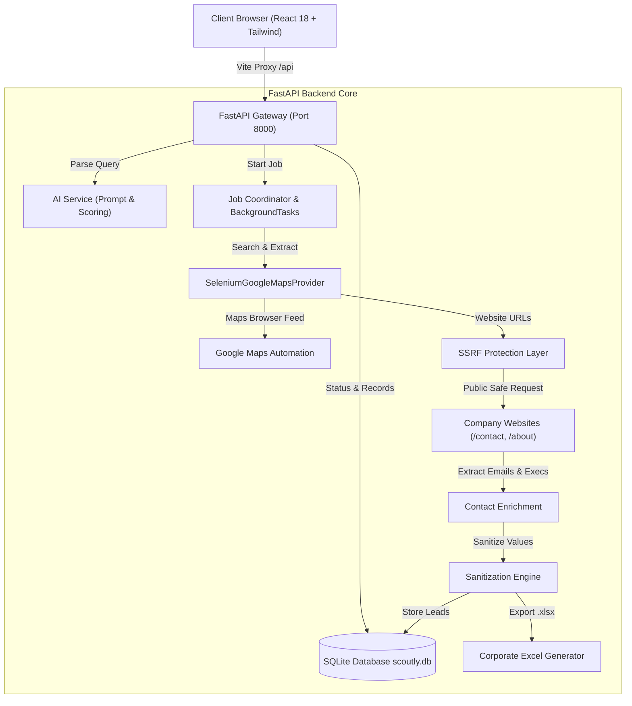
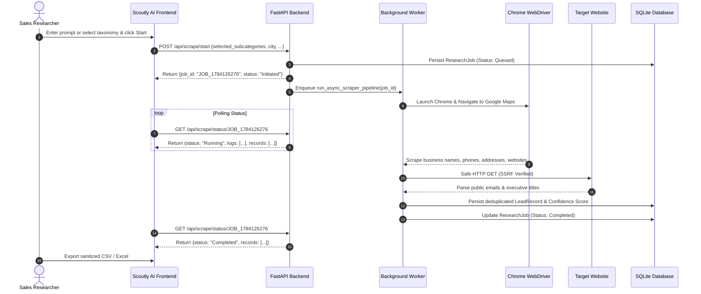

# System Design Document — Scoutly AI

---

## 1. Sequence Diagram: Lead Research Pipeline

---

## 2. Deduplication & Data Identity Model

To prevent duplicate records from inflating lead metrics, Scoutly AI generates a deterministic deduplication hash:

$$\text{DedupKey} = \text{SHA256}(\text{normalized}(\text{FirmName}) + \text{"::"} + \text{normalized}(\text{City}) + \text{"::"} + \text{normalized}(\text{WebsiteHost}))$$

This guarantees stable uniqueness even if listings have slight punctuation variations.

